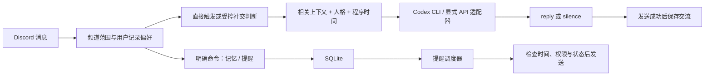

# GPT娘 2.0：思路、方案与实施步骤

## 目标与评价

原建议方向正确：持续的群友感来自稳定的人格、共享情境、记得有依据的事情，以及知道何时不说话。单纯增加提示词、反复随机发言或伪造离线日记，会让她更吵，也容易出现前后矛盾。

“有生活感”在本项目中是一种可观察的行为连续性，不是宣称 AI 拥有独立意识。白发龙娘会表达偏好、承认错误、保持自己的语气；程序则提供真实时间和可核验记忆。

## 架构

Discord 提供收发与身份；Codex 负责理解和表达；Python 常驻服务负责调度、记忆、频率与失败处理。模型不掌管权限或额度。

## 之前所有方向如何落地

| 思路 | 本次结果 | 后续改进 |
| --- | --- | --- |
| Codex直接接入Bot | 已实现 CLI 桥接，现有登录可复用，结构化输出 | 如需更低启动开销，再评估 SDK/app-server |
| 长期人格 | 更新决策原则、矛盾、边界，保留白发龙娘 | 依据群主认可资料做离线人格蒸馏 |
| 短期/长期记忆 | 频道观察、成功交流、明确保存的事实分开 | 带来源/置信度/过期时间的候选记忆 |
| 不必每条都回 | mention/observe/social；允许silence | 根据真实聊天回放调整门槛 |
| 主动关心 | 明确提醒可持久化、取消、查询 | “明天考试”先形成可确认事件，再问是否跟进 |
| 独立状态 | 实际时间、安静时段和冷却 | 少量可解释的兴趣/精力状态，不能编造真实经历 |
| 长期目标、反思、日记 | 此次未加入 | 由真实事件形成短摘要，评估价值后再做 |
| 关系感 | 当前用户明确记忆与真实历史 | 不用简单“好感度”推导恋爱或亲密关系 |
| QQ、语音、图片 | 此次未加入 | 平台适配与多模态分别验证 |

## 为什么 Codex 可以接 Discord

“直接接”可以理解为 Discord 服务调用 `codex exec`。不需要操控桌面聊天窗口。官方非交互模式支持 stdin、结构化输出和无历史会话模式；这次已做一次合成请求的真实连接验证。

仍需一个常驻桥接程序接收 Gateway 事件、选择频道和上下文、调用 Codex、把结果发回 Discord。现有桌面聊天内容不会自动成为机器人的记忆；本次选择每轮 ephemeral + 本地SQLite，让删除和频道隔离可控。

Codex 登录使用部署账号的产品权限及限额；API 是独立适配器。不能把前者说成“无限免费”，也不能把旧 API 的0.10加元日预算套用到 Codex。

官方资料：[非交互模式](https://learn.chatgpt.com/docs/non-interactive-mode)、[CLI参数](https://learn.chatgpt.com/docs/cli/reference)、[认证](https://learn.chatgpt.com/docs/auth)。

## Codex-Remote-Contact 借鉴

审阅版本：[8412335](https://github.com/Epic0522/Codex-Remote-Contact/tree/8412335abbe38cd0633aff7cc1a6486283b7defc)。

可借鉴的是工程结构：先观察再决定、群聊缓冲与真正参与的对话分开、识别提及和引用、抑制复读、记录决策及发送结果。此次以独立实现的频道缓冲、silence协议、成功发送后入库、短期重复抑制落实。

不照搬其大型服务文件、macOS专有逻辑或远程电脑执行能力。审阅的核心中，部分增强/统一记忆模块是可选接口，缺失时会回退；不能把接口名字当成完整自主生活系统已实现的证据。该项目不是本项目运行依赖。

## nuwa-skill 借鉴

审阅版本：[7c7edfe](https://github.com/alchaincyf/nuwa-skill/tree/7c7edfeb9d90a28b1f79e7847e1ba27a698cdc24)。

这里的“蒸馏”主要是把资料提炼为角色思维、选择方式、语气、价值冲突与边界，生成提示规则；不是训练模型权重。适合离线完善人格，不适合每条群消息跑昂贵研究流程。

本项目采用的步骤：

1. 群主指定设定优先；整理资料出处，区分官方信息、同人理解、原创示例。
2. 抽取“怎么做选择”，例如爱面子与事实准确冲突时选择纠错。
3. 用少量有差异的例子展示语气，不把口头禅频率当成人格。
4. 编译为短运行人格和决策规则。
5. 用未写进人格提示的场景验收，再决定是否接受改动。

nuwa 的结构检查不能证明人格还原程度；此次新增的人工验收集也不冒充已经完成的真人盲测。没有调用它的研究流程或安装此技能。

## DeepSeek 接 QQ：流程与借鉴

此前研究中，接入方案可归纳为“QQ平台适配器 → 消息规范化 → 会话/策略 → 模型接口 → 回复”。DeepSeek 本身提供模型API，并不负责QQ收发。

后续试验建议：

1. 先选择 QQ 官方机器人通道，按当前平台要求完成创建、凭证、测试群/权限配置。
2. 采用支持该通道的框架（例如 AstrBot），配置 QQ 平台连接。
3. 在框架里配置 DeepSeek 供应商、API Key、接口地址和当前可用模型，先在私有测试范围跑通。
4. 再验证@、群上下文、引用、消息长度、速率与重连；按能力配置主动消息。
5. 将平台能力映射到本项目同样的事件结构，复用记忆与策略，而非复制整个机器人。

社区 OneBot/NapCat 路线通常是 QQ 客户端桥接 → OneBot WebSocket/HTTP → 框架 → DeepSeek；登录、连接鉴权、事件格式和账号风控与官方通道不同，不作为本次部署前提。

关于“官方QQ能否读全部群消息/主动发消息”：此前不同年代资料有冲突；不能一概说不行，也不能保证所有应用都支持。按当前账号后台、框架版本和测试群实际能力验收。
参考：[QQ开放平台](https://q.qq.com/)、[AstrBot 文档](https://docs.astrbot.app/)、[DeepSeek API](https://api-docs.deepseek.com/)。

可借鉴的是接入分层、事件规范化、会话键和重连/限流；仅仅换成 DeepSeek 不会自动得到持续人格或记忆。

## 实施与上线顺序

1. **本次代码更新**：模型适配器、显式配置、SQLite状态、社交编排、提醒、人格规则及测试。
2. **本地检查**：运行模拟测试；用合成句子做一次 Codex 实际连接自检。与真实Discord验收分开记录。
3. **测试频道 mention**：检查@、连续对话、清空、停止记录、重启及提醒。
4. **observe**：开启Message Content Intent，只观察指定测试频道；确认上下文正确、没有跨频道材料。
5. **social**：先低额度运行，人工统计该沉默却插话、该回应却漏掉、复读、过时跟进和人格偏差。
6. **第二阶段**：候选事件/记忆需要确认、可修订与取消；再考虑关系摘要和轻量状态。
7. **第三阶段**：有实际需要时增加QQ、多模态或更复杂调度。

回退：停止新进程，恢复旧代码并使用原API配置及原预算数据库。保留新 `data/` 以免误删显式记忆；旧版不会读取它。不要同时运行新旧进程。

## 本次验收记录

2026-10-28：本地Python 3.13、discord.py 2.7.1，34项自动测试通过；模拟测试与真实Codex合成连接分别运行。真实连接使用 `codex-cli 0.165.0-alpha.1.2` 和已有ChatGPT登录，结构化返回成功，未发送Discord消息。

随后四步已上线并由用户验收，记录见 [ROLLOUT_2026-10-28.md](docs/ROLLOUT_2026-10-28.md)。本轮先保存GitHub检查点，再改进对话接续和收件人判断、移除人为日限、增加可选联网查证，详情见 [CONVERSATION_UPDATE.md](docs/CONVERSATION_UPDATE.md)。长期运行和自然度仍需持续观察。

## 自主兴趣分享阶段

连续群聊验收后新增后台兴趣搜索、来源核验、简短分享文案、表情附件/视频链接、发送去重和管理员暂停控制。实现及验收见 [INTEREST_SHARING.md](docs/INTEREST_SHARING.md)。兴趣为可配置的人设偏好；关系画像、自动记忆和多模态观看仍不属于此次更新。

